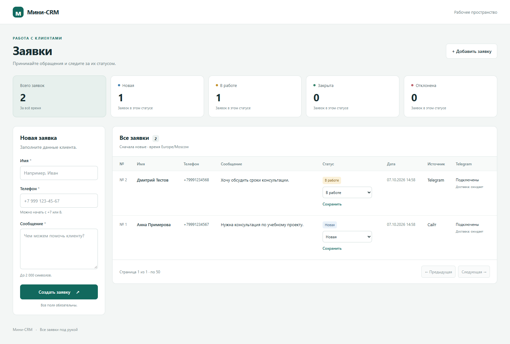

# Мини-CRM для управления клиентскими заявками

**Docker:** [сборка, запуск, постоянные данные и доступ к серверу](docs/docker.md).
Три компонента запускаются через Docker Compose; интерфейс по умолчанию доступен
только локально или через SSH-туннель. В контейнере используется Waitress.

Локальное учебное приложение: замена Excel единым списком клиентских заявок.
Использует Flask, Pydantic 2, SQLAlchemy 2 и SQLite.
Создаёт заявки, возвращает список с пагинацией и меняет статусы.
Русскоязычный интерфейс работает на Jinja2, статистика кешируется через cachetools.
Добавлены Telegram-бот, подписка на статусы и постоянная очередь уведомлений.
Без настройки Telegram основная CRM работает самостоятельно.



Это настоящий скриншот Chromium после добавления Telegram. Вымышленные данные
внесены вручную в отдельную тестовую БД; ожидающие сообщения не отправлялись в Telegram.
**При обычном первом запуске список пуст: демонстрационные заявки не создаются.**

## Требования задания и согласованные расширения

Основа исходного задания: самостоятельный сервис, приём JSON-заявок,
валидация, постоянное хранение в SQLite, просмотр списка, модульный код,
автоматические тесты и инструкция запуска.

Согласованные расширения: русскоязычная форма на Jinja2, смена статусов,
адаптивная страница с пагинацией, счётчики и кеш статистики. Они реализованы
и входят в приёмку. Следующий согласованный этап добавляет Telegram-диалог,
одноразовую подписку с сайта, историю статусов и очередь доставки.

## Стек и проверенные версии

Установка с нуля проверена в Windows, **Python 3.12.9**, PowerShell.
Рекомендуется Python 3.12. SQLite используется через стандартный модуль Python.

| Библиотека | Версия | Назначение |
| --- | --- | --- |
| Flask | 3.1.3 | Веб-приложение и Blueprints |
| Pydantic | 2.13.5 | Валидация |
| SQLAlchemy | 2.0.54 | ORM и транзакции SQLite |
| Jinja2 | 3.1.6 | HTML-шаблоны |
| cachetools | 7.2.1 | Кеш счётчиков |
| tzdata | 2026.5 | Часовые пояса на Windows и других ОС |
| pytest | 9.1.1 | Автоматические тесты |
| pytest-cov | 7.1.0 | Покрытие Python-кода |

Прямые версии закреплены в `requirements.txt`, транзитивные — в `constraints.txt`,
который автоматически применяется при установке. FastAPI, Abstract и «Дадаты» нет.

## Запуск в Windows PowerShell

Используйте Python 3.12. Выполняйте команды из корня проекта, где находится README.
Установка зависимостей требует доступа к реестру пакетов; после установки основная
CRM и тесты работают без внешних API и ключей. Telegram включается отдельно.

```powershell
python -m venv .venv
.\.venv\Scripts\python.exe -m pip install -r requirements.txt
.\.venv\Scripts\python.exe -m pip check
.\.venv\Scripts\python.exe -m flask --app app.main:create_app run --host 127.0.0.1 --port 5000
```

Откройте <http://127.0.0.1:5000/> — страницу менеджера.
JSON API остаётся доступен по `/leads`. Для остановки сервера нажмите Ctrl+C.
Запуск не требует активации окружения или изменения политики PowerShell.
Для повторного запуска достаточно последней команды; данные сохранятся.
Если порт занят, остановите свой предыдущий сервер либо замените `--port 5000`
на свободный порт и используйте его в адресе браузера и примерах запросов.

## Запуск в Linux/macOS

Команды приведены для самостоятельного запуска; на этих ОС они в рамках сдачи
не выполнялись. Из корня проекта:

```bash
python3 --version
python3 -m venv .venv
.venv/bin/python -m pip install -r requirements.txt
.venv/bin/python -m pip check
.venv/bin/python -m flask --app app.main:create_app run --host 127.0.0.1 --port 5000
```

В некоторых дистрибутивах Linux модуль `venv` устанавливается отдельным пакетом
операционной системы. Активация окружения не требуется.

Если создание окружения завершилось ошибкой `ensurepip`, а его Python уже создан:

```powershell
python -m pip --python .venv/Scripts/python.exe install -r requirements.txt
```

## Хранение и настройки

При первом запуске автоматически создаются файл `instance/crm.sqlite3` и таблицы.
Повторный запуск сохраняет данные. При добавлении таблиц Telegram в существующую
базу автоматически создаётся резервная копия в `backups/` рядом с файлом БД.
Таблица заявок не перестраивается; повторное обновление безопасно. Путь можно изменить:

```powershell
$env:DATABASE_PATH = 'instance/my-crm.sqlite3'
```

Относительный путь всегда разрешается от корня проекта, независимо от текущей
рабочей директории. Абсолютные пути тоже поддерживаются. `.env.example` описывает
настройки. CRM, бот и обработчик автоматически читают `.env` из корня проекта;
уже заданные переменные окружения имеют приоритет. Для основной CRM ключи не нужны.
Для интеграции нужны переменные из [инструкции Telegram](docs/telegram.md).

В Linux/macOS переменные задаются в том же терминале перед запуском:

```bash
export DATABASE_PATH='instance/my-crm.sqlite3'
export UI_TIMEZONE='Europe/Moscow'
```

Для настроек по умолчанию ничего задавать не нужно. Существующую БД не удаляйте
ради перезапуска или обновления схемы. Перед переносом сохраните копию файла
при остановленном приложении.

Каждый запрос получает отдельную сессию, которая гарантированно закрывается.
Сервисы управляют транзакциями: ответ об успехе формируется после commit,
исключения записи приводят к rollback. UTC хранится в SQLite без смещения;
в JSON `created_at` содержит явное обозначение UTC (`Z`).

## Веб-интерфейс

На `/` расположены форма, таблица, смена статусов, пагинация и счётчики всех заявок.
Форма отправляет JSON в `POST /lead`, кнопка «Сохранить» у статуса — в
`PATCH /lead/{id}/status`. После создания список и счётчики обновляются на месте;
новая заявка показывается на первой странице, а смена статуса сохраняет текущую страницу.
При включённой интеграции форма предлагает одноразовую ссылку подписки на Telegram.
Таблица показывает источник заявки, подписку и результат последней доставки.
Ошибки полей отображаются рядом с полями. При ошибке серверного ответа или связи
введённые значения сохраняются, кнопки разблокируются для повтора. Пока запрос
выполняется, повторная отправка этой формы блокируется.

Интерфейс адаптируется к телефону. Для записи нужен JavaScript; чтение и
пагинация работают без него. Пользовательский текст экранируется Jinja2,
сообщения JavaScript выводятся через `textContent`. Внешних CDN и шрифтов нет.

Параметры страницы совпадают с API: `/?limit=50&offset=0`.
Даты показываются в формате `ДД.ММ.ГГГГ ЧЧ:ММ`. Часовой пояс по умолчанию —
`Europe/Moscow`; его можно изменить перед запуском:

```powershell
$env:UI_TIMEZONE = 'Asia/Vladivostok'
```

Используется стандартный `zoneinfo` и пакет `tzdata`, обеспечивающий базу часовых
поясов в том числе на Windows. В SQLite и JSON API время остаётся UTC.
Название часового пояса должно быть действительным идентификатором IANA.

## Кеш статистики

`GET /stats` возвращает счётчики по всем заявкам, независимо от пагинации:

```json
{"total": 4, "new": 1, "in_progress": 1, "closed": 1, "rejected": 1}
```

HTML и JSON вызывают один сервис `app/services/statistics.py`, а агрегирующий
запрос `GROUP BY` расположен в репозитории. HTML не обращается по HTTP к API.
`app/cache/statistics.py` хранит только счётчики в `cachetools.TTLCache` на
30 секунд. Каждый экземпляр приложения получает собственный кеш; фабрика сессий
передаёт его сервисам через `Session.info`, без зависимости сервисов от Flask.

Чтение, заполнение и сброс кеша защищены блокировкой. SQL выполняется вне неё.
При сбросе увеличивается номер поколения: если запись произошла во время
расчёта, старый результат отбрасывается, а расчёт повторяется в новой транзакции.
Сервисы сбрасывают кеш только после успешного commit; неуспешная операция его
не меняет. Вызывающему коду выдаются копии счётчиков.

Режим работы — **один процесс** с возможными параллельными потоками. После
перезапуска первый запрос статистики читает SQLite и заново заполняет кеш.
Изменения напрямую в SQLite, минуя сервисы, видны после истечения TTL; несколько
процессов не синхронизируют кеш друг с другом.

## API

| Метод | Адрес | Результат |
| --- | --- | --- |
| GET | `/` | Страница менеджера, `200` |
| POST | `/lead` | Созданная заявка, `201` |
| GET | `/leads?limit=50&offset=0` | Список JSON, `200` |
| PATCH | `/lead/{id}/status` | Обновлённая заявка, `200` |
| GET | `/stats` | Счётчики всех заявок, `200` |
| POST | `/integrations/telegram/leads` | Создание ботом с авторизацией и идемпотентностью, `201` |
| POST | `/integrations/telegram/bind` | Подтверждение подписки с авторизацией, `200` |

Тела новых запросов и настройки авторизации описаны в [инструкции Telegram](docs/telegram.md#защищённый-http-api).
При включённой интеграции ответ `POST /lead` дополнительно содержит
`telegram_subscription_url`. В `GET /leads` и ответах изменения статуса ссылки нет.

### Создание: `POST /lead`

Заголовок `Content-Type: application/json`, тело:

```json
{"name": "Иван", "phone": "+7 999 123-45-67", "message": "Хочу консультацию"}
```

Все три поля обязательны и строго строковые. Имя после удаления пробелов по краям
имеет длину 1–100, сообщение — 1–2000. Телефон принимает `+79991234567`,
`89991234567`, `+7 999 123-45-67`, `8 (999) 123-45-67` и нормализуется в
`+79991234567`. Буквы, добавочные номера и посторонние символы отклоняются.
Проверяется только формат, а не существование номера или принадлежность России.
Один номер можно использовать в нескольких заявках.

Ответ `201`: объект с полями `id`, `name`, `phone`, `message`, `status`, `created_at`.
Начальный статус — `new`. Неизвестные поля, включая переданные клиентом `id`,
`status`, `created_at`, запрещены.

### Список: `GET /leads?limit=50&offset=0`

`limit`: целое число 1–100, по умолчанию 50. `offset`: целое число от 0,
по умолчанию 0. Неизвестные и повторяющиеся параметры отклоняются.
Порядок: `created_at DESC, id DESC`. `total` — количество всех заявок.

```json
{"items": [], "total": 0, "limit": 50, "offset": 0}
```

### Статус: `PATCH /lead/1/status`

```json
{"status": "in_progress"}
```

Разрешены `new`, `in_progress`, `closed`, `rejected`. Переход возможен между любыми
из этих статусов; повтор текущего статуса тоже допустим. Ответ `200` — обновлённая
заявка. Если заявка отсутствует, ответ `404`.

| Код | Название в интерфейсе |
| --- | --- |
| `new` | Новая |
| `in_progress` | В работе |
| `closed` | Закрыта |
| `rejected` | Отклонена |

Примеры ответов (id и дата назначаются сервером и будут отличаться).
После POST, HTTP `201`:

```json
{"id":1,"name":"Иван","phone":"+79991234567","message":"Хочу консультацию","status":"new","created_at":"2026-10-07T10:00:00Z"}
```

После PATCH, HTTP `200`:

```json
{"id":1,"name":"Иван","phone":"+79991234567","message":"Хочу консультацию","status":"in_progress","created_at":"2026-10-07T10:00:00Z"}
```

GET списка с одной заявкой после смены статуса, HTTP `200`:

```json
{"items":[{"id":1,"name":"Иван","phone":"+79991234567","message":"Хочу консультацию","status":"in_progress","created_at":"2026-10-07T10:00:00Z"}],"total":1,"limit":50,"offset":0}
```

### Пример запросов в PowerShell

Выполняйте в другом терминале при работающем сервере:

```powershell
$body = @{ name = 'Иван'; phone = '8 (999) 123-45-67'; message = 'Хочу консультацию' } | ConvertTo-Json
$lead = Invoke-RestMethod -Method Post -Uri 'http://127.0.0.1:5000/lead' -ContentType 'application/json; charset=utf-8' -Body ([Text.Encoding]::UTF8.GetBytes($body))
Invoke-RestMethod -Uri 'http://127.0.0.1:5000/leads?limit=10&offset=0'
Invoke-RestMethod -Method Patch -Uri "http://127.0.0.1:5000/lead/$($lead.id)/status" -ContentType 'application/json' -Body '{"status":"in_progress"}'
Invoke-RestMethod -Uri 'http://127.0.0.1:5000/stats'
```

### Пример запросов в Linux/macOS

```bash
curl -i -X POST http://127.0.0.1:5000/lead \
  -H 'Content-Type: application/json' \
  --data '{"name":"Иван","phone":"8 (999) 123-45-67","message":"Хочу консультацию"}'
curl 'http://127.0.0.1:5000/leads?limit=10&offset=0'
# Замените 1 идентификатором из ответа POST.
curl -i -X PATCH http://127.0.0.1:5000/lead/1/status \
  -H 'Content-Type: application/json' --data '{"status":"in_progress"}'
curl http://127.0.0.1:5000/stats
```

### Ошибки

| HTTP | Код | Значение |
| --- | --- | --- |
| 400 | `invalid_json` | Повреждённый или пустой JSON |
| 415 | `unsupported_media_type` | Нужен JSON Content-Type |
| 422 | `validation_error` | Некорректные поля, структура тела или параметры |
| 404 | `lead_not_found` / `not_found` | Неизвестная заявка / маршрут |
| 405 | `method_not_allowed` | Неподдерживаемый HTTP-метод |
| 500 | `internal_error` | Непредвиденная ошибка |
| 401 | `unauthorized` | Нет авторизации интеграции |
| 409 | `integration_conflict` | Несовместимый повтор или недействительный код привязки |

Сообщения — на русском. Пример ответа `422`:

```json
{"error":{"code":"validation_error","message":"Проверьте поля и параметры запроса.","details":[{"field":"name","code":"missing","message":"Обязательное поле."}]}}
```

Ответы не содержат SQL, трассировок или внутренних путей. Серверный журнал
содержит только класс неожиданной ошибки, без SQL, параметров запросов и токенов.

Неверный формат id не совпадает с маршрутом и возвращает `404 not_found`.
Внутренние ошибки Pydantic обрабатываются как `500`, а не ошибки полей клиента.

## Модули

```text
CRM/
├── app/
│   ├── main.py
│   ├── config.py
│   ├── errors.py
│   ├── views.py
│   ├── schemas/           # lead.py, telegram.py
│   ├── services/
│   │   ├── leads.py
│   │   ├── statistics.py
│   │   ├── telegram.py
│   │   └── notifications.py
│   └── cache/statistics.py
├── api/                   # leads.py, telegram.py
├── bot/                   # main.py, handlers.py, state.py, config.py
├── integrations/          # http.py, crm.py, telegram.py
├── workers/notifications.py
├── database/
│   ├── base.py
│   ├── session.py
│   ├── init_db.py
│   ├── migrations.py
│   └── repositories/      # leads.py, telegram.py, outbox.py
├── models/                # lead.py, telegram.py
├── templates/
│   ├── base.html
│   └── leads.html
├── static/
│   ├── css/styles.css
│   └── js/leads.js
├── tests/
├── docs/
│   ├── screenshots/leads.png
│   ├── verification.md
│   ├── telegram.md
│   └── telegram-verification.md
├── README.md
├── requirements.txt
├── constraints.txt
├── pytest.ini
├── .env.example
└── .gitignore
```

Все Python-пакеты содержат `__init__.py`. `instance/` создаётся при запуске.
Виртуальные окружения, `.env`, SQLite, кеши и `artifacts/` исключены из Git.

- `app/main.py` — фабрика, настройки, ресурсы и Blueprints.
- `api/leads.py` — JSON-маршруты; `app/views.py` — HTML-маршрут и форматирование дат.
- `app/schemas/lead.py` — валидация и схемы ответов.
- `app/services/leads.py` — операции и транзакции без зависимости от Flask.
- `database/repositories/leads.py` — запросы SQLAlchemy без зависимости от Flask.
- `database/session.py` — подключение и жизненный цикл сессий.
- `database/init_db.py`, `database/base.py`, `models/lead.py` — схема БД и ORM.
- `templates/base.html`, `templates/leads.html` — общая структура и страница менеджера.
- `static/css/styles.css`, `static/js/leads.js` — оформление и работа форм с API.
- `app/cache/statistics.py`, `app/services/statistics.py` — кеш и сервис статистики.
- `bot/` — отдельный polling-процесс, диалог, постоянные черновики и входящие события.
- `integrations/` — HTTP-клиенты CRM и Telegram; бот не пишет в таблицы CRM напрямую.
- `api/telegram.py`, `app/schemas/telegram.py` — защищённые маршруты и проверка данных.
- `app/services/telegram.py`, `notifications.py` — привязка, история и подготовка сообщений.
- `models/telegram.py`, новые репозитории — таблицы интеграции и SQL-запросы.
- `workers/notifications.py` — отдельный обработчик постоянной очереди.
- `database/migrations.py` — добавление таблиц с резервной копией существующей БД.

В БД установлены `NOT NULL` и `CHECK` для длин, телефона и допустимых статусов.
Ограничения длины не полагаются на `VARCHAR(n)` в SQLite.
SQL отсутствует в маршрутах и шаблонах. Создание заявки реализовано один раз
в сервисе; форма обращается к тому же API. Циклов в графе импортов не обнаружено.

## Автоматические проверки

PowerShell:

```powershell
.\.venv\Scripts\python.exe -m pytest -q
.\.venv\Scripts\python.exe -m pytest -q --cov=app --cov=api --cov=database --cov=models --cov-report=term-missing
```

Linux/macOS:

```bash
.venv/bin/python -m pytest -q
.venv/bin/python -m pytest -q --cov=app --cov=api --cov=database --cov=models --cov-report=term-missing
```

Тесты используют отдельную временную SQLite для каждого сценария и не меняют
рабочую базу. Если стандартная временная папка недоступна, укажите отдельную
папку только для тестов (pytest очищает её при повторном запуске):

```powershell
New-Item -ItemType Directory -Force artifacts | Out-Null
.\.venv\Scripts\python.exe -m pytest -q --basetemp=artifacts/pytest-tmp --cov=app --cov=api --cov=database --cov=models --cov-report=term-missing
```

Проверяются создание и commit, строгая валидация, телефон, границы длин,
повторяющиеся номера, пагинация и сортировка, все статусы, ошибки HTTP,
ограничения БД, rollback при ошибках flush/commit, закрытие сессий,
сохранение после пересоздания приложения и разрешение путей.

Дополнительно проверяются HTML и пустой список, экранирование пользовательского
HTML, адреса API в формах, пагинация страницы, три часовых пояса с переходом даты,
общие счётчики, повторное чтение из кеша, TTL через управляемые часы без ожидания,
сброс после успешной записи, сохранение кеша при ошибке, гонка расчёта со сбросом,
защита от изменения возвращённых счётчиков, изоляция приложений и восстановление
из SQLite. После добавления Telegram весь набор содержит **164 теста**:
все прошли, покрытие Python-кода всех компонентов — **91%**. Покрытие не относится
к JavaScript/CSS; реальные запросы в Telegram в тестах не выполняются.

Для включения новых компонентов в отчёт покрытия добавьте
`--cov=bot --cov=integrations --cov=workers` к команде выше.
Проверены идемпотентность и конкурирующие отправки, потеря ответа после commit,
восстановление диалогов и очередей, привязка, авторизация, контакты, rollback,
порядок уведомлений, сетевые ошибки/429/403 и время события.

Все 164 теста также выполнены в окружении предыдущей чистой установки, в обратном
порядке и с запрещёнными сетевыми подключениями. `pip check` не выявил конфликтов.
На предыдущем этапе установка с нуля проверена в отдельном окружении; версии
зависимостей не изменились. HTTP-клиенты используют стандартную библиотеку Python,
новых пакетов не требуется. [Отчёт предыдущих трёх этапов](docs/verification.md)
сохранён как история проверки. [Текущий отчёт Telegram](docs/telegram-verification.md)
отделяет выполненные проверки от ограничений.

## Telegram: настройка и запуск

Создайте бота через **@BotFather** и задайте `TELEGRAM_BOT_TOKEN`,
`TELEGRAM_BOT_USERNAME`, `CRM_BASE_URL=http://127.0.0.1:5000` и отдельный общий
`CRM_BOT_API_TOKEN` в окружении. Не публикуйте и не присылайте токены в чат.
Пошаговый безопасный ввод секретов, примеры API, подписка с сайта, восстановление
после сбоев и сценарий проверки описаны в **[инструкции Telegram](docs/telegram.md)**.

В трёх терминалах с подготовленным окружением, из корня проекта:

```powershell
# Терминал 1
.\.venv\Scripts\python.exe -m flask --app app.main:create_app run --host 127.0.0.1 --port 5000
# Терминал 2
.\.venv\Scripts\python.exe -m bot.main
# Терминал 3
.\.venv\Scripts\python.exe -m workers.notifications
```

В Linux/macOS используйте `.venv/bin/python`. Нужен исходящий HTTPS-доступ к
Telegram Bot API; публичный домен/webhook не требуется. Один экземпляр каждого
компонента. Данные и очередь — в SQLite, состояние бота — в отдельной SQLite.
Бот отправляет JSON в защищённый `POST /integrations/telegram/leads`; общая
бизнес-логика CRM и сброс кеша остаются в существующих сервисах.

## Ограничения учебной версии и непроверенные сценарии

Основной интерфейс и API менеджера пока без авторизации и предназначены только
для локального запуска. Секрет интеграции защищает два новых маршрута; перед
сетевым доступом потребуется защита всего API и доступа менеджеров.
VK-бот, внешняя проверка телефонов и публичное развёртывание не реализованы.

Реальную отправку проверяйте отдельно после настройки токенов и запуска компонентов.
Автотесты используют подменённый Telegram API. Проверены веб-форма, ссылка подписки,
источник/подписка/ожидание доставки, статусы и пагинация в Chromium.
Linux проверен внутри Docker: 168 тестов прошли без сети. Нативный запуск
Linux/macOS, Safari/Firefox, физические телефоны и нагрузка не проверялись.
Постоянного автоматического E2E-набора нет. Мобильный вид проверяется эмуляцией.

Один подтверждённый черновик бота создаёт одну заявку за счёт постоянного ID.
Для обычной веб-формы серверная идемпотентность не добавлялась: потеря ответа
после сохранения может привести к дублю при ручной повторной отправке.
Доставка уведомлений может повториться, если Telegram принял сообщение, но его
ответ потерялся; абсолютная однократная доставка не обещается.
Автоматической очистки истории, повторной выдачи ссылки подписки и восстановления
заблокированных подписок нет. Подробности ошибок и повторов — в инструкции Telegram.

Веб-часть развёрнута в Docker на сервере с доступом через SSH-туннель.
Публичный доступ и перенос Telegram-процессов не выполнены;
подробности в [отчёте Docker](docs/docker-verification.md).
